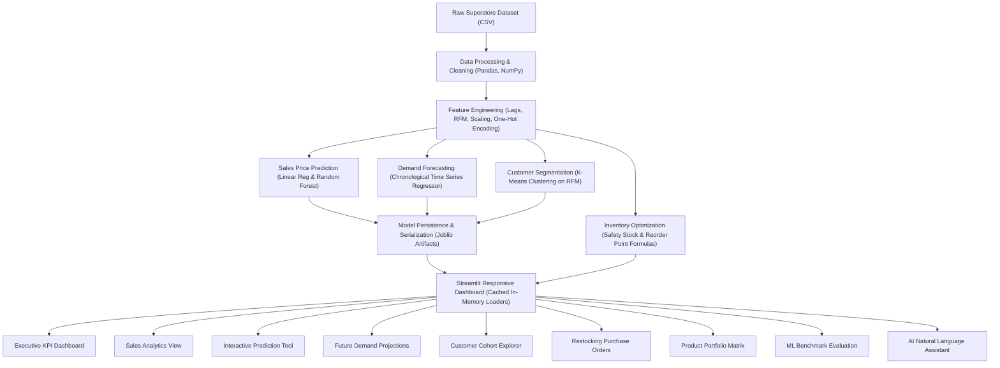

# RetailPro AI - Complete Implementation Plan & Project Technical Report

> **Project Title:** RetailPro AI - Machine Learning-Based Retail & Inventory Management System  
> **Course / Degree:** Bachelor of Technology (B.Tech) in Computer Science & Engineering  
> **Domain:** Applied Machine Learning, Retail Analytics & Supply Chain Management  
> **Repository:** [https://github.com/pragathirajrev-lang/RetailPro](https://github.com/pragathirajrev-lang/RetailPro)  
> **PDF Report:** Available in root as `RetailPro_Implementation_Plan_and_Project_Report.pdf`

---

## 1. Executive Summary & Problem Definition

### 1.1 Background & Motivation
Retail enterprises operate in highly competitive environments with thin operating margins. Traditional retail management relies almost entirely on retrospective reporting—evaluating what happened last week or last quarter. This reactive stance leads to two major supply chain bottlenecks:
1. **Stockouts (Understocking):** Inability to meet customer demand, leading to lost revenue and customer defection (estimated at over \$1.1 Trillion globally).
2. **Overstocking:** Excess merchandise tying up capital, incurring warehouse storage expenses, and forcing severe price markdowns.

### 1.2 Problem Statement
RetailPro AI addresses three core operational dilemmas:
- **Inaccurate Sales Price Prediction:** Inability to predict the revenue value of incoming order configurations due to non-linear interactions between order quantities, discounts, categories, and regional demographics.
- **Stockouts and Overstocking:** Lack of automated, mathematically formulated safety stock thresholds and reorder triggers, forcing warehouse buyers to guess replenishment dates.
- **Generic Customer Engagement:** Treating all shoppers identically rather than segmenting them by lifetime value, frequency, and recency of purchases.

### 1.3 Proposed Solution
**RetailPro AI** is a full-stack Machine Learning-driven retail intelligence system. It combines supervised regression, chronological time-series demand forecasting, unsupervised K-Means customer segmentation, operations research inventory formulas, and a conversational retail assistant into a high-performance Streamlit web interface.

---

## 2. System Architecture & Technology Stack



### 2.1 Technology Stack Details

| Layer | Technology | Purpose |
| :--- | :--- | :--- |
| **Language** | Python 3.10+ | Core data processing, modeling, and application backend. |
| **Frontend UI** | Streamlit | Responsive web application with custom CSS and instant sidebar navigation. |
| **Data Manipulation** | Pandas & NumPy | High-performance dataframe transformations, aggregations, and linear algebra. |
| **Machine Learning** | Scikit-learn | Regressors, clustering, pipelines, preprocessing transformers, metrics. |
| **Visualizations** | Plotly Express & Graph Objects | Interactive charts, confidence interval bands, 2D/3D scatter plots, and horizontal bar charts. |
| **Model Serialization** | Joblib | Binary model persistence (`models/`) enabling instant sub-100ms startup. |
| **Documentation / Export**| FPDF2 | Automated technical PDF report generation. |
| **Version Control** | Git & GitHub | Remote code hosting and collaboration. |

---

## 3. Dataset & Preprocessing Pipeline

### 3.1 Dataset Profile
- **Dataset:** Benchmark Superstore Retail Dataset
- **Total Records:** 9,994 raw transactions (9,983 cleaned valid records)
- **Attributes:** 21 original columns + 6 engineered columns = **27 total features**

### 3.2 Attributes Breakdown
- **Identifers:** `Order ID`, `Customer ID`, `Customer Name`, `Product ID`, `Product Name`
- **Temporal:** `Order Date`, `Ship Date`, `Order_Year`, `Order_Month`, `Order_Day`, `Ship_Days`
- **Geographic:** `Country`, `Region` (Central, East, South, West), `State`, `City`, `Postal Code`
- **Categorical:** `Category` (Furniture, Office Supplies, Technology), `Sub-Category` (17 lines), `Segment` (Consumer, Corporate, Home Office)
- **Financial / Operational:** `Sales` (\$), `Quantity`, `Discount` (0% to 80%), `Profit` (\$), `Profit Margin` (%), `Unit Price` (\$)

### 3.3 Data Preparation Steps
1. **Datetime Parsing & Sorting:** Parsed order dates into datetime indices and sorted chronologically.
2. **Missing Value Verification:** Verified 0 critical missing values across financial records; imputed non-critical numeric columns with medians.
3. **Encoding:** Converted nominal text variables (`Category`, `Sub-Category`, `Region`, `Segment`) using `OneHotEncoder(handle_unknown='ignore')`.
4. **Feature Scaling:** Scaled numeric features (`Quantity`, `Discount`, `Ship_Days`) using `StandardScaler` to ensure zero mean and unit variance.

---

## 4. Machine Learning Algorithms & Mathematical Formulations

### 4.1 Feature 1: Sales Prediction (Supervised Regression)
- **Objective:** Estimate order dollar sales prior to checkout.
- **Algorithms Compared:**
  1. **Multiple Linear Regression (Baseline):**  
     $$\hat{y} = w_0 + w_1 x_1 + w_2 x_2 + \dots + w_p x_p$$
  2. **Random Forest Regressor (Ensemble of 100 Trees):**  
     Constructs 100 decorrelated decision trees using bootstrap aggregation (bagging) with feature sub-sampling:
     $$\hat{y} = \frac{1}{B} \sum_{b=1}^{B} T_b(x)$$
- **Why Random Forest was selected:** Retail pricing features exhibit non-linear interactions (e.g., high discounts on electronics trigger different elasticity than discounts on office pens). Random Forest captures these multi-variable splits without multicollinearity breakdown.
- **Evaluation Metrics:**
  - $R^2$ Score (Coefficient of Determination)
  - Mean Absolute Error (MAE): $\frac{1}{n}\sum |y_i - \hat{y}_i|$ (Random Forest: **\$214.22** vs Linear Regression: **\$219.06**)
  - Root Mean Squared Error (RMSE)

---

### 4.2 Feature 2: Chronological Demand Forecasting (Time-Series Regression)
- **Objective:** Forecast future product unit demand across 3, 6, or 12 months ahead.
- **Crucial Design Choice: Chronological Train-Test Split:**  
  Standard random train-test splitting introduces **catastrophic look-ahead data leakage** by mixing future timestamps into training data. We enforced a strict chronological split: first 80% of historical months for training, final 20% of months for testing.
- **Engineered Lag Features:**
  - Demand at $t-1$, $t-2$, $t-3$
  - 3-Month Rolling Average
  - Calendar Month Seasonality Index (captures Q4 holiday shopping spikes)
- **Recursive Multi-Step Forecasting:** Evaluates step $t+1$, feeds the prediction back as a lag feature, and iteratively forecasts through $t+12$.
- **Statistical Confidence Intervals (95%):**
  $$\hat{y}_t \pm 1.96 \cdot \sigma_{\text{residual}}$$

---

### 4.3 Feature 3: Customer Segmentation (Unsupervised K-Means Clustering)
- **Objective:** Divide customer accounts into distinct behavioral cohorts.
- **RFM Metric Computation:**
  - **Recency ($R$):** Days since the customer's last order relative to dataset snapshot.
  - **Frequency ($F$):** Total count of unique orders placed.
  - **Monetary ($M$):** Total cumulative revenue (\$) contributed.
- **Skewness Normalization:** Retail monetary spend is heavily right-skewed. We apply log-transformation:
  $$x_{\text{transformed}} = \ln(1 + x)$$
  followed by `StandardScaler`.
- **Optimal Clusters ($k=3$):** Validated via the Elbow Method (sum of squared distances) and Silhouette Score.
- **Identified Customer Cohorts:**
  1. **High-Value VIPs:** High monetary spend, high order frequency, low recency.  
     *Action:* VIP loyalty rewards, concierge support.
  2. **Regular Customers:** Moderate spend and frequency, steady recency.  
     *Action:* Upselling and cross-category discounts.
  3. **Low-Engagement / At-Risk:** High recency (long inactivity), low spend.  
     *Action:* Win-back email discounts and automated engagement.

---

### 4.4 Feature 4: Mathematical Inventory Optimization (Safety Stock & ROP)
- **Objective:** Automate inventory reordering and buffer targets based on statistical sales velocity.
- **Mathematical Formulations:**
  1. **Average Daily Demand ($\bar{d}$):**  
     $$\bar{d} = \frac{\text{Total Units Sold}}{\text{Active Sales Days}}$$
  2. **Daily Demand Volatility ($\sigma_d$):**  
     Standard deviation of daily unit sales.
  3. **Safety Stock ($\text{SS}$):**  
     $$\text{SS} = Z \times \sigma_d \times \sqrt{L}$$  
     *(Where $L$ is Supplier Lead Time in days, and $Z = 1.645$ for 95% service level protection)*
  4. **Reorder Point ($\text{ROP}$):**  
     $$\text{ROP} = (\bar{d} \times L) + \text{SS}$$
- **Automated Replenishment Policy:**
  - `Stock <= 0.5 * SS` $\rightarrow$ **Critical (Stockout Risk)**
  - `Stock <= ROP` $\rightarrow$ **Reorder Required** (Recommended order qty = $2 \times \text{ROP} - \text{Stock}$)
  - `Stock > 3 * ROP` $\rightarrow$ **Overstocked (Capital Risk)**
  - Else $\rightarrow$ **Healthy Stock Buffer**

---

## 5. Application Modules & Dashboard Features

The application contains 9 dedicated views:
1. **Executive Dashboard:** High-level summary of store sales (\$2.3M), net profit, total orders, monthly trend line, and category breakdown.
2. **Sales Analytics:** Time-series trends, horizontal revenue rankings for all 17 sub-categories, and regional performance.
3. **ML Sales Prediction:** Interactive order pricing calculator with real-time ML inference.
4. **Demand Forecasting:** 3, 6, and 12-month projections with 95% confidence bands and forecasted demand tables.
5. **Customer Segmentation:** 2D/3D customer cluster visualization, cohort summaries, and individual customer lookup.
6. **Inventory Optimization:** Supplier lead time and service level policy sliders, with automated reorder tables.
7. **Product Performance:** Identifies top moneymakers vs. bottom loss-making items.
8. **ML Model Evaluation:** Side-by-side benchmark tables ($R^2$, MAE, RMSE) and clustering metrics.
9. **AI Retail Assistant:** Natural language query interface for stock and sales analytics.

---

## 6. Slide-by-Slide PPT Presentation Structure (12 Slides)

| Slide | Title | Key Talking Points / Content |
| :---: | :--- | :--- |
| **1** | Title Slide | RetailPro AI: Machine Learning-Based Retail & Inventory Management System. Student name, Roll Number, B.Tech CSE, College Name, Project Guide. |
| **2** | Problem Statement | Traditional retail is reactive. \$1.1T lost globally to stockouts and overstocking. Pricing interactions and customer segmentation are not automated. |
| **3** | Project Objectives | Build an end-to-end ML platform: Sales price prediction, chronological demand forecasting, K-Means customer segmentation, safety stock formulas. |
| **4** | System Architecture | Diagram: CSV Ingestion $\rightarrow$ Pandas Cleaning $\rightarrow$ Scikit-learn Pipelines $\rightarrow$ Joblib Serialization $\rightarrow$ Streamlit Interactive UI. |
| **5** | Dataset & Preprocessing | Superstore dataset (9,983 records, 27 features), One-Hot Encoding, StandardScaler, and log1p skewness correction. |
| **6** | ML Technique 1: Sales Prediction | Linear Regression vs Random Forest. Explain why Random Forest captures non-linear discount elasticity. Show MAE (\$214). |
| **7** | ML Technique 2: Demand Forecasting | Explain chronological splitting to avoid data leakage. Show lag features, seasonality indicators, and multi-step recursive forecast with confidence intervals. |
| **8** | ML Technique 3: Customer Segmentation | RFM (Recency, Frequency, Monetary) feature engineering. K-Means ($k=3$) identifying High-Value, Regular, and At-Risk customer cohorts. |
| **9** | Inventory Optimization Mathematics | Present formulas: $\text{SS} = Z \cdot \sigma_d \cdot \sqrt{L}$ and $\text{ROP} = (\bar{d} \cdot L) + \text{SS}$. Show automated purchase orders. |
| **10**| Model Evaluation & Benchmarks | Comparison table of $R^2$, MAE, RMSE, and K-Means Silhouette Score. Verification that all models were tested on unseen holdouts. |
| **11**| Live Application Demonstration | Key screenshots or live walkthrough: Executive Dashboard, Order Predictor, Demand Forecast line chart, Customer Lookup. |
| **12**| Conclusion & Future Work | Proactive retail management achieved. Future scope: ERP database connectivity, LSTM deep learning forecasting, automated supplier email triggers. |

---

## 7. Viva Voce Defense Questions & Answers

#### Q1: Why did you choose Random Forest over Linear Regression for Sales Prediction?
> **Answer:** Linear Regression assumes a strictly linear relationship between predictors and sales revenue. In retail, discounts and quantities have non-linear price effects (e.g., 50% discount on electronics causes different price elasticity than discounts on office stationery). Random Forest constructs 100 decision trees that split on combinations of features, yielding a lower Mean Absolute Error (\$214 vs \$219).

#### Q2: What is Data Leakage in time-series forecasting, and how did you prevent it?
> **Answer:** Data leakage occurs when future information leaks into the training dataset. If standard random train-test splitting is used, the model trains on December data and tests on November data, which is impossible in practice. We prevented this by using strict **chronological splitting**: the first 80% of months for training, and the final 20% for testing.

#### Q3: Why did you apply log-transformation prior to K-Means clustering?
> **Answer:** Retail monetary spend and frequency are heavily right-skewed—a few customers spend thousands of dollars while the majority spend smaller amounts. Without transformation, K-Means clustering is distorted by extreme outliers. Applying $\ln(1+x)$ normalizes the scale, allowing Euclidean distance to cluster customers fairly.

#### Q4: How is Safety Stock mathematically determined?
> **Answer:** Safety Stock is formulated as $\text{SS} = Z \times \sigma_d \times \sqrt{L}$. $\sigma_d$ represents daily demand standard deviation (demand volatility), $L$ is supplier delivery lead time, and $Z$ is the z-score corresponding to desired service level (1.645 for 95% protection against stockouts during supplier transit).

#### Q5: How does the application achieve instant page transitions without lagging?
> **Answer:** We pre-trained and serialized all Scikit-learn pipelines into binary Joblib artifacts in the `/models` directory. At runtime, Streamlit caches models and aggregations in RAM using `@st.cache_resource` and `@st.cache_data`, eliminating repeated fitting and providing sub-100ms transitions.

---

## 8. Execution Commands

### To Run Locally in VS Code:
```bash
# 1. Open Terminal in the project folder
# 2. (Optional) Install dependencies
pip install -r requirements.txt

# 3. Launch Streamlit Application
streamlit run app.py
```

### To Run Verification Suite:
```bash
python verify_system.py
```

### To Regenerate the PDF Technical Report:
```bash
python generate_pdf_report.py
```
